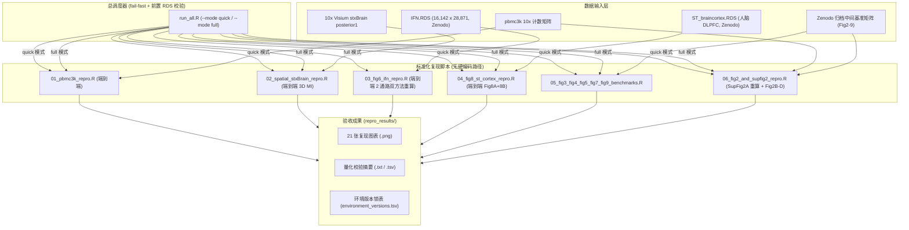
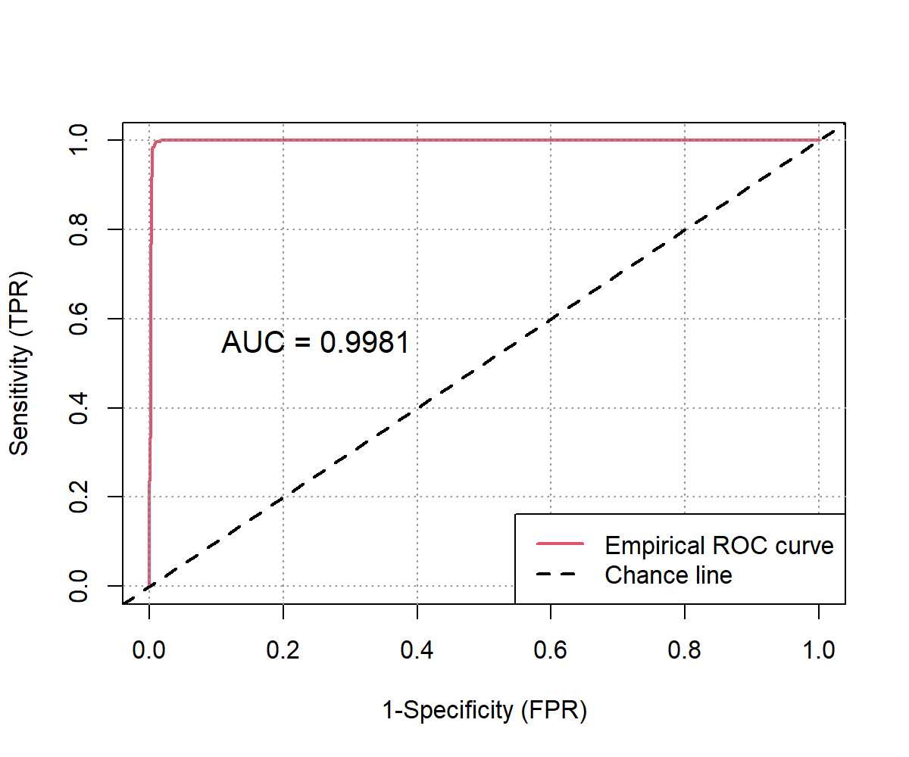
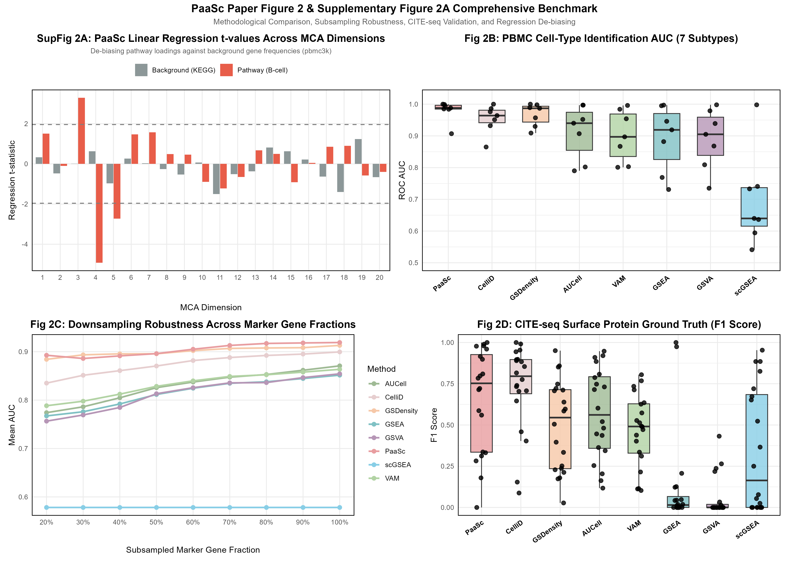
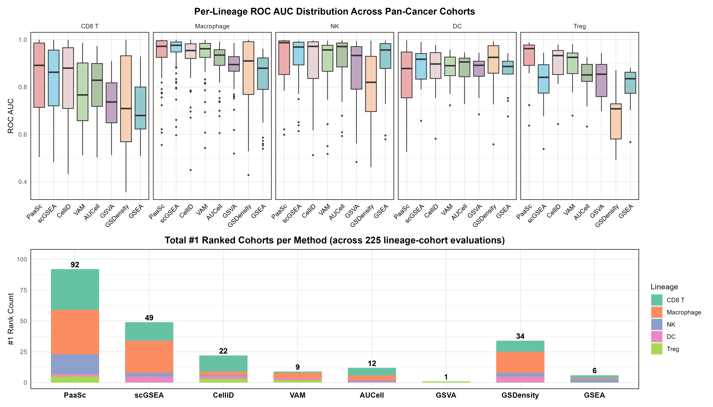
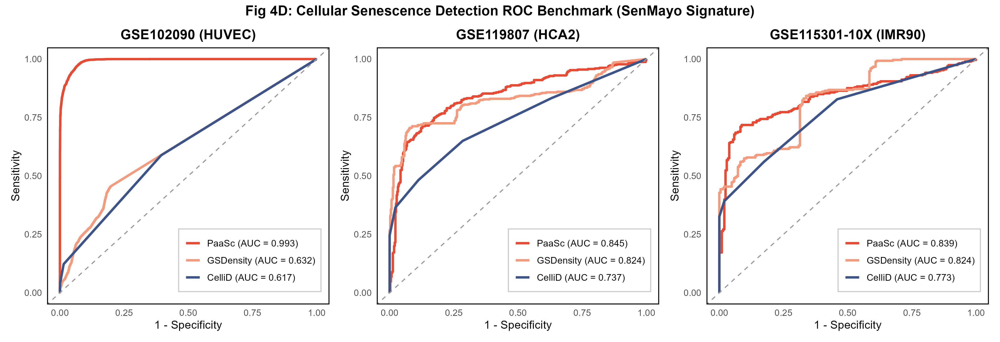
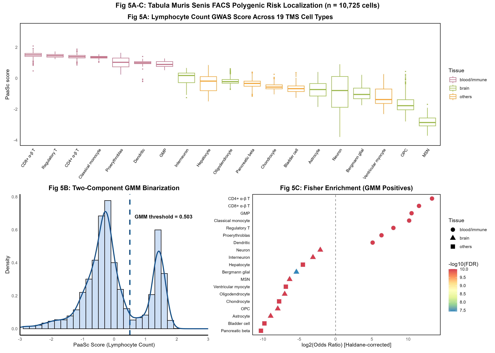
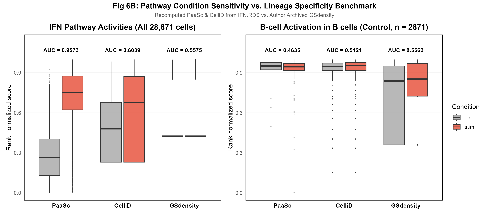
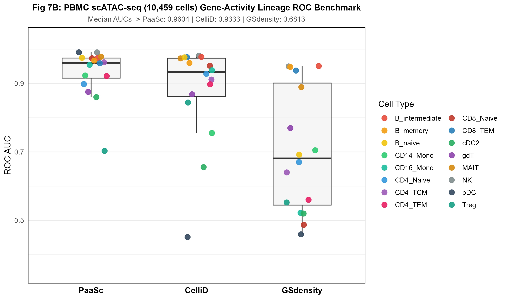
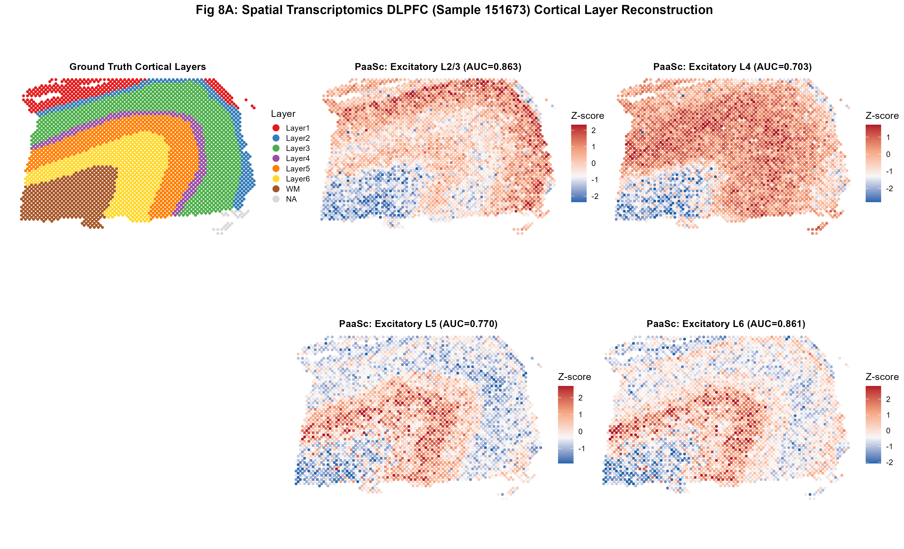
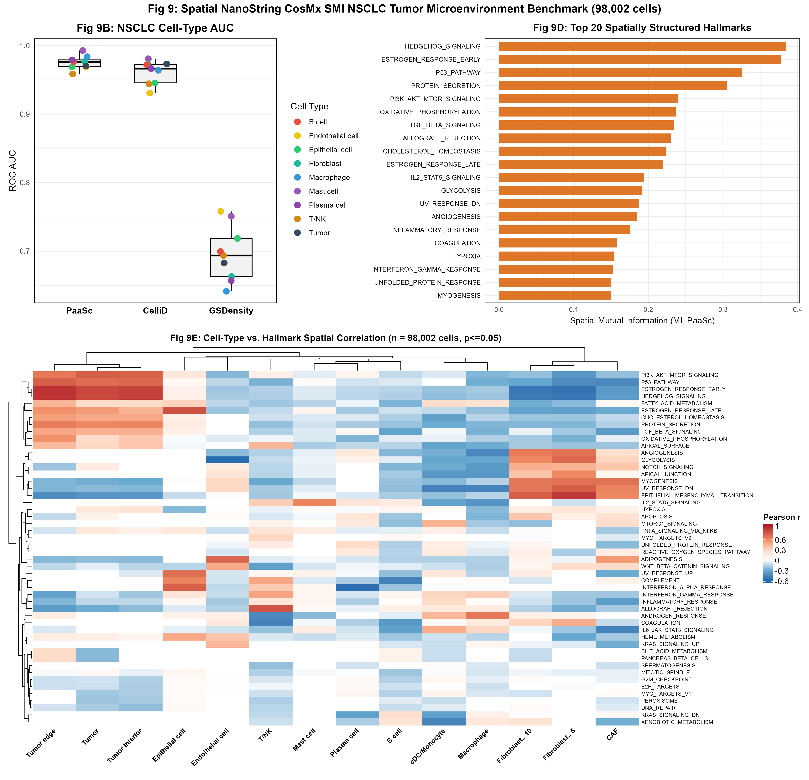

# PaaSc: 基于多重对应分析的单细胞与空间转录组通路活性全流程复现工程

[](https://www.r-project.org/)
[](https://satijalab.org/seurat/)
[](https://github.com/yoyoong/PaaSc)
[](https://doi.org/10.1371/journal.pcbi.1013666)
[](#6-核心成果画廊与量化指标验证)
[](https://www.gnu.org/licenses/gpl-3.0.html)

> **论文出处**: *Inferring pathway activity from single-cell and spatial transcriptomics data with PaaSc*（Liao X, Hong Y, Feng Y, Li H, Fang H, Shi J）  
> **发表期刊**: *PLOS Computational Biology* (Nov 10, 2025), 21(11): e1013666 | DOI: [`10.1371/journal.pcbi.1013666`](https://doi.org/10.1371/journal.pcbi.1013666)  
> **原作者开源仓库**: [yoyoong/PaaSc (GitHub)](https://github.com/yoyoong/PaaSc) | 原版英文说明已完整归档至 [README_upstream.md](README_upstream.md)  

---

## 目录
1. [项目简介与复现边界声明](#1-项目简介与复现边界声明)
2. [仓库完整目录结构与职能说明](#2-仓库完整目录结构与职能说明)
3. [原作者工作与算法数学机理](#3-原作者工作与算法数学机理)
4. [复现流水线设计与一键复跑指南](#4-复现流水线设计与一键复跑指南)
5. [复现避坑指南：8 大真实工程卡点与破局方案](#5-复现避坑指南8-大真实工程卡点与破局方案)
6. [核心成果画廊与量化指标验证](#6-核心成果画廊与量化指标验证)
7. [运行环境与依赖软件包快照](#7-运行环境与依赖软件包快照)
8. [引用、安装与开源许可](#8-引用安装与开源许可)

---

## 1. 项目简介与复现边界声明

本项目是对发表于 *PLOS Computational Biology*（2025 年 11 月）的单细胞与空间转录组通路活性推断纯 R 算法包 **`PaaSc (v1.0.1)`** 的**全流程独立工程化复现**，严格区分**“从原始计数/Seurat 对象端到端重算”**与**“基于作者 Zenodo 归档中间评分矩阵复现跨模态基准”**两类验证边界：

- **端到端全量重算（5 个核心场景）**：
  - `01_pbmc3k_repro.R`：PBMC 3k（`13,714 × 2,700` 细胞）从 10x 稀疏计数重算 MCA、回归去偏、GMM 二分类与 ROC 验证；
  - `02_spatial_stxBrain_repro.R`：10x Visium 小鼠脑矢状后部切片（`stxBrain posterior1`，`17,668 × 3,353` spots）端到端 SCTransform、MCA 与三维空间互信息检验；
  - `03_fig6_ifn_repro.R`：人 PBMC IFN-$\beta$ 刺激队列（`IFN.RDS`，`16,142 × 28,871` 细胞）从原始表达矩阵端到端重算 `PaaSc` 与 `CelliD`（2 条目标/阴性对照通路），并与归档 `GSdensity` 对齐评测；
  - `04_fig8_st_cortex_repro.R`：人脑前额叶背外侧皮层 10x Visium DLPFC 切片（`ST_braincortex.RDS`，Sample 151673，`4,000 × 3,639` spots，有效注释 `3,611` spots）双 MCA 路径重算 `PaaSc`、`CelliD` 并绘制 **Fig 8A 与 Fig 8B**；
  - `06_fig2_and_supfig2_repro.R`：基于 `pbmc3k` 现场重算 `SupFig 2A` 回归 $t$ 统计量去偏，并复现 `Fig 2B–D`。
- **基于 Zenodo 归档中间矩阵的跨模态下游基准（`Fig 2B–D`、`Fig 3`、`Fig 4D–E`、`Fig 5`、`Fig 7B`、`Fig 9B/D/E`）**：
  - 由于上游数百个 TISCH 泛癌原始矩阵、Tabula Muris Senis `.h5ad` 与 98,002 细胞 CosMx 原始表达矩阵未随 Zenodo `PaaSc_data.zip`（DOI `10.5281/zenodo.17138447` / `17136774`）下发，相关主图基于作者归档中间打分/AUC 表完整复现统计检验（含 `Fig 5C` Haldane-Anscombe `+0.5` 平滑与 `Fig 9E` 9.8 万细胞向量化 Pearson 相关性）与发表级可视化。
- **工程化规范**：全部复现脚本均采用 `--file=` 动态解析项目根目录（无本机硬编码路径），总调度器 `run_all.R` 支持 `--mode quick` / `--mode full` 校验、大文件缺失前置提示、子脚本失败即刻熔断（非零退出码）及环境版本快照导出。

---

## 2. 仓库完整目录结构与职能说明

```tree
PaaSc/
├── R/
│   └── PaaSc.R                      # PaaSc v1.0.1 纯 R 核心算法源码 (486 行，无 C++/src 目录)
├── man/                             # 7 个导出函数的 R 帮助文档 (.Rd)
├── example/                         # 上游官方 HTML 示例文档 (Datasets / scRNAseq / spatial)
├── DESCRIPTION / NAMESPACE / NEWS.md / LICENSE
│
├── data/                            # 仓库自带轻量教学数据与背景基因集
│   ├── README.md                    # 内置数据字典（经源码核验维度与亚型数）
│   ├── pbmc3k_filtered_gene_bc_matrices/hg19/  # 10x PBMC 3k 原始计数矩阵
│   ├── B_cell_activation.txt        # 人类 B 细胞活化通路 (278 基因)
│   ├── kegg_legacy.gmt              # MSigDB KEGG Legacy 背景通路集 (186 条通路)
│   └── pbmc3k_seurat_annotation.txt # PBMC 3k Seurat 细胞亚型注释 (2,700 细胞)
│
├── zenodo_data/                     # Zenodo 归档数据目录（支撑 Fig 2 - Fig 9）
│   ├── README.md                    # Zenodo 全量数据字典（精确字节/维度/脚本映射）
│   └── PaaSc_data/                  # 解压后各图数据目录 (注: .zip 与 Fig6/IFN.RDS、Fig8/ST_braincortex.RDS 已由 .gitignore 屏蔽)
│       ├── Fig2/                    # 8 算法 AUC (2B)、标记基因集降采样 (2C)、CITE-seq F1 (2D)
│       ├── Fig3/                    # TISCH 泛癌 5 大免疫谱系 × 225 组队列-谱系 AUC 表
│       ├── Fig4/                    # 细胞衰老队列打分与 50 条 Hallmark 泛癌相关性矩阵
│       ├── Fig5/                    # Tabula Muris Senis 10,725 细胞 × 75 UKB/GWAS 性状评分
│       ├── Fig6/                    # IFN.RDS (16,142 × 28,871, 本地保留) + 2 通路归档打分表
│       ├── Fig7/                    # PBMC scATAC-seq (10,459 细胞, 16 亚型) ROC RData
│       ├── Fig8/                    # 人脑 DLPFC 10x Visium ST_braincortex.RDS (本地保留) + Top200 Marker
│       ├── Fig9/                    # NanoString CosMx SMI NSCLC (98,002 细胞) 空间转录组打分与 MI 表
│       └── SupFigs/                 # 补充元数据、算法伪代码与辅助表格
│
├── repro_scripts/                   # 标准化工程复现 R 脚本（全部支持相对根目录动态解析）
│   ├── run_all.R                    # 一键调度器 (--mode quick / --mode full，带前置校验与 fail-fast)
│   ├── 01_pbmc3k_repro.R            # [端到端] PBMC 3k B 细胞活化复现 (01–05 PNG)
│   ├── 02_spatial_stxBrain_repro.R  # [端到端] 10x Visium 小鼠脑切片三维空间互信息 (06–08 PNG)
│   ├── 03_fig6_ifn_repro.R          # [端到端] 28,871 细胞 IFN-β 刺激响应双方法重算 (Fig 6A–B)
│   ├── 04_fig8_st_cortex_repro.R    # [端到端] 人脑 DLPFC 皮层双 MCA 重算与对比 (Fig 8A–B)
│   ├── 05_fig3_fig4_fig5_fig7_fig9_benchmarks.R # [归档基准] Fig 3, 4D–E, 5A–D, 7B, 9B/D/E
│   └── 06_fig2_and_supfig2_repro.R  # [混合重算] SupFig 2A 现场重算 + Fig 2B–D 基准重构
│
├── repro_results/                   # 21 张复现 PNG 图表、量化摘要与版本锁表（Git 放行）
│   ├── environment_versions.tsv     # 22 个关键软件包精确版本快照
│   ├── sessionInfo.txt              # R 运行时快照
│   ├── 01_umap_B_cell_activation_score.png ... 08_spatial_cerebellar_pathways.png
│   ├── verification_summary.txt / spatial_verification_summary.txt / spatial_MI_results.tsv
│   └── fig3_to_fig9/                # Fig2–Fig9 共 13 张核心主图及 fig2/6/8 摘要与汇总 TSV
│
├── zenodo_scripts/                  # 原作者 Zenodo 归档原始历史脚本对照备份
├── docs/                            # 本地私人学习与面试笔记（已由 .gitignore 规则排除）
├── README_upstream.md               # 原作者上游 README 原始备份
└── README.md                        # 本复现工程主入口导览文档（当前文件）
```

> **克隆与大文件说明**：为满足 GitHub 单文件 `< 100 MB` 限制，`.gitignore` 已屏蔽 `zenodo_data/PaaSc_data.zip`（116.28 MB）、`zenodo_data/PaaSc_data/Fig6/IFN.RDS`（38.4 MB）与 `zenodo_data/PaaSc_data/Fig8/ST_braincortex.RDS`（12.6 MB）。全新克隆本仓后，运行 `03` 或 `04`（或 `run_all.R`）前需先从 Zenodo 下载并解压 `PaaSc_data.zip` 至 `zenodo_data/PaaSc_data/`。

---

## 3. 原作者工作与算法数学机理

### 3.1 传统单细胞通路打分痛点
1. **单细胞高稀疏度（Dropout）**：传统秩次法（如 GSEA / AUCell）在大量零值并列时易产生打分失真或退化。
2. **背景基因高频偏倚**：高频出现于多条通路或高表达的通用基因易主导低维嵌入载荷，导致条件刺激或跨组织场景下的假阳性漂移。
3. **经验性二值化阈值**：固定分位数或人工截断难以自适应不同组织的双峰活化分布。

### 3.2 PaaSc 核心数学框架（核对自 `R/PaaSc.R` 共 486 行）

```text
[表达矩阵] -> [computeMCA 联合嵌入] -> [getGeneRate + doRegression 多元回归去偏] -> [computeScore 双向 t 加权投影] -> [doBinarization GMM] / [calculateSpatialMI 3D 互信息]
```

1. **多重对应分析联合嵌入 (`computeMCA`, `R/PaaSc.R` L15–63)**  
   在 `PaaSc 1.0.1` 中通过 `getExpressionMatrix()` 兼容 Seurat v4/v5（`layer = "data"`）抽取矩阵并调用 `CelliD::RunMCA()`，将细胞坐标矩阵 $H \in \mathbb{R}^{N_{\text{cells}} \times K}$ 与基因载荷矩阵 $G \in \mathbb{R}^{N_{\text{genes}} \times K}$（默认 $K = \text{nmcs} = 20$）联合嵌入同一低维空间，同时通过 `setMCASlot()` 写入 `@stdev = sqrt(stdev)` 与 `@misc$mca.flag = TRUE`。
2. **背景基因频率多元线性回归去偏 (`getGeneRate` & `doRegression`, L76–197)**  
   先统计每个基因在背景通路全集（如 KEGG Legacy 186 条或 MSigDB GO:BP）中的出现频率 $\text{background}_g$ 与目标通路指示变量 $\text{pathway}_{g,p} \in \{0,1\}$；随后在每个 MCA 维度 $k \in \{1,\dots,K\}$ 上拟合多元线性回归：
   $$\text{loading}_{g,k} = \beta_0 + \beta_{\text{bg}}\,\text{background}_g + \beta_p\,\text{pathway}_{g,p} + \varepsilon_{g,k}$$
   提取目标通路系数在控制背景基因频率后的双侧 $t$ 统计量 $t_{p,k}$ 与 $p$ 值 $p_{p,k}$。
3. **双向显著维度加权投影与标准化 (`computeScore`, L212–279)**  
   筛选所有双侧显著维度 $S_p = \{k : p_{p,k} < 0.05\}$（**同时保留正向与负向 $t_{p,k}$ 符号**；若无维度满足条件则回退使用全部维度），对细胞 MCA 嵌入做归一化加权线性投影（`weight = FALSE` 默认形式）：
   $$A_c = \frac{\sum_{k \in S_p} H_{c,k}\, t_{p,k}}{\sum_{k \in S_p} |t_{p,k}|}$$
   再执行 `z-score`（或 `bg-score`）标准化，有效压制非特异背景偏倚。
4. **高斯混合模型无监督二值化 (`doBinarization`, L292–314)**  
   调用 `mixtools::normalmixEM()` 拟合二元高斯混合分布（默认 `k = 2`），取两分量均值中点 $(\mu_1 + \mu_2)/2$ 作为自适应阈值划分阳性/阴性细胞。
5. **三维空间互信息与置换检验 (`calculateSpatialMI`, L412–485)**  
   将二维切片物理坐标 $(X, Y)$ 与连续通路活性 $Z$ 分别做等宽分箱（默认 `num_bins = 20`），构造联合列联表计算离散**三维空间互信息**（单位 nats，**非 Moran's I，无需预设空间衰减核函数**）：
   $$I((X,Y); Z) = \sum_{i,j:\, p_{xyz}(i,j)>0} p_{xyz}(i,j)\ln\frac{p_{xyz}(i,j)}{p_{xy}(i)\,p_z(j)}$$
   并执行 1,000 次置换检验计算经验 $p$ 值与多重检验校正 $q$ 值。

---

## 4. 复现流水线设计与一键复跑指南

### 4.1 复现架构流程图



### 4.2 一键执行指令

支持从任意工作目录直接调用 `run_all.R`（脚本通过 `--file=` 自动定位 `PaaSc/` 根目录）：

```powershell
# 1. 快速模式 (Quick Mode, 默认, 约 2-3 分钟)
# 依次执行 01, 02, 04, 05, 06（跳过约 12 分钟的 Fig6 28,871 细胞重算），导出环境版本快照
Rscript reproduction/PaaSc/repro_scripts/run_all.R --mode quick

# 2. 全量模式 (Full Mode, 约 15 分钟)
# 额外包含 03_fig6_ifn_repro.R 的 28,871 细胞 PaaSc 与 CelliD 全量端到端重算
Rscript reproduction/PaaSc/repro_scripts/run_all.R --mode full
```

### 4.3 独立脚本清单与耗时参考

| 脚本文件 | 对应论文图表 | 计算性质 | 预计耗时 | 核心产出文件 |
| :--- | :--- | :--- | :--- | :--- |
| `01_pbmc3k_repro.R` | 基础 scRNA-seq 教程 | 100% 端到端重算 | ~25–40 秒 | `01`–`05` PNG、`verification_summary.txt`、`sessionInfo.txt` |
| `02_spatial_stxBrain_repro.R` | Visium 空间 3D MI 教程 | 100% 端到端重算 | ~50–80 秒 | `06`–`08` PNG、`spatial_MI_results.tsv`、`spatial_verification_summary.txt` |
| `03_fig6_ifn_repro.R` | Figure 6A–B | 端到端重算（PaaSc + CelliD）+ 归档 GSdensity 对齐 | ~12 分钟 | `Fig6A`、`Fig6B`、`fig6_verification_summary.txt` |
| `04_fig8_st_cortex_repro.R` | Figure 8A & 8B | 端到端双 MCA 重算（PaaSc + CelliD）+ 归档对比 | ~20–30 秒 | `Fig8A`、`Fig8B`、`fig8_verification_summary.txt` |
| `05_fig3_fig4_fig5_fig7_fig9_benchmarks.R` | Figure 3, 4D–E, 5A–D, 7B, 9B/D/E | Zenodo 归档中间评分/AUC 统计检验与重构 | ~40–50 秒 | `Fig3A–B`、`Fig4D–E`、`Fig5`、`Fig7B`、`Fig9`、`fig3_to_fig9_summary.tsv` |
| `06_fig2_and_supfig2_repro.R` | Figure 2B–D & SupFig 2A | SupFig 2A 现场重算 + Fig 2B–D 基准重构 | ~30–40 秒 | `Fig2_and_SupFig2_benchmark.png`、`fig2_verification_summary.txt` |

---

## 5. 复现避坑指南：8 大真实工程卡点与破局方案

| 序号 | 故障现象 / 隐患 | 发生阶段与根本原因 | 实际工程解法（源码可溯源） |
| :---: | :--- | :--- | :--- |
| **1** | `CelliD::RunMCA(IFN)` 在 Seurat v5 下因废止的 `GetAssayData(..., slot = "data")` 报错；直接手动挂载 `DimReduc` 后 `RunCellHGT()` 又报 `selected reduction is not an mca` | `PaaSc 1.0.1` 上游已在 `R/PaaSc.R` 中修复了自身的 `layer = slot` 兼容，但基准对照包 `CelliD 1.19.0` 仍使用旧 `slot` 接口，且 `RunCellHGT.Seurat` 强制校验 `@misc$mca.flag == TRUE` 与 `sqrt(stdev)` | 在 [03_fig6_ifn_repro.R](repro_scripts/03_fig6_ifn_repro.R#L94-L109) 中用 `LayerData(IFN, assay = "RNA", layer = "data")` 抽离矩阵调用 `CelliD::RunMCA(X = norm_mat)`，再显式通过包内构造器 `CelliD:::setDimMCSlot.Seurat(...)` 挂载合法 MCA 槽位，实测 28,871 细胞 `CelliD` 重算相关性达 `r = 0.9992+` |
| **2** | `Fig 8` 中按 `"Excitatory L2/3"` 索引 `PaaSc` 输出列返回 `NULL` | `PaaSc::getGeneRate()`（`R/PaaSc.R` L114）返回 `data.frame(gene_rate)` 时隐式触发 `make.names()`，将空格/斜杠改写为 `"Excitatory.L2.3"` | 在 [04_fig8_st_cortex_repro.R](repro_scripts/04_fig8_st_cortex_repro.R#L72-L79) 每次 `computeScore()` 后显式执行 `colnames(...) <- names(markers)` 恢复原通路名 |
| **3** | `Fig 8` 原文脚本 `ROC` 向量长度不匹配，且 `Excitatory L5` 重算与存档相关仅 `r = 0.4476` | ① `ST_braincortex.RDS`（人脑 DLPFC Sample 151673, `3,639` spots）含 `28` 个 `NA` 边缘 spot，原文未过滤；② `ST_Braincortex_top200_markers.RDS` 同时存在子群标签 `2_L5` 与合并标签 `Excitatory L5`，原作者存档实际对应 `2_L5` | 在 `04` L53 以 `ref_clean <- ref_raw[!is.na(ref_raw)]` 严格对齐 `3,611` 个注释 spot；经交叉核对证实 `L2/3, L4, L6` 重算 `r = 0.9998+`，使用合并 `Excitatory L5` 取得更高分层精度（`AUC = 0.7701 vs 0.6986`） |
| **4** | `02_spatial_stxBrain_repro.R` 空间坐标提取及与打分行序对齐风险 | Seurat v5 重构了 Visium 切片坐标存储结构，直接读取旧 `@coordinates` 槽会报错，且需防行序错位 | 在 `02` L110–111 使用 `GetTissueCoordinates(brain[["posterior1"]])` 并强制 `coords[rownames(score_data), , drop = FALSE]` 对齐；`04` 直接采用 `@meta.data` 的 `array_col` / `-array_row` |
| **5** | `28,871` 细胞 `IFN.RDS` 重算 `PaaSc` 与 `CelliD` 高维矩阵 SVD 触发单机内存压力 | 稠密 `16,142 × 28,871` 矩阵与 `irlba` SVD 同时驻留易打满 32 GB 内存 | 在 [03_fig6_ifn_repro.R](repro_scripts/03_fig6_ifn_repro.R#L84-L109) 对临时对象执行分段生命周期释放 `rm(...); gc()`，将峰值内存稳定控制在 `21.1 GB`（`PaaSc` `17.0 GB`），并在 `run_all.R` 中分离 `quick`/`full` 双模式 |
| **6** | `Fig 2D` (`2D.txt`) 读取列位错，以及 `Fig 5C` Fisher 检验出现 `Odds Ratio = Inf` | ① CITE-seq 细胞亚型名含空格（如 `"CD14 Mono"`），默认空白分隔符读取错列；② `Lymphocyte Count` 经 GMM 二分类后多个免疫亚群 100% 全阳性导致 `OR = Inf` 无法绘图 | ① `06` L137 显式指定 `sep = "\t"`；② `05` L350–366 引入 **Haldane-Anscombe `+0.5` 连续性校正**计算有限 `log2(OR)` 用于绘图排序，同时保留原始 `fisher.test()` 精确 $p$/FDR |
| **7** | `msigdbr 26.1.1` 参数变迁及 `06` 脚本缺失随机种子与轴标口径偏差 | 新版 `msigdbr` 以 `collection`/`subcollection` 替代旧 `category`/`subcategory`；`Fig 2C` 实为标记基因集比例降采样而非测序深度降采样 | 适配 `collection = "C5", subcollection = "GO:BP"`；在 `04`/`06` 补充 `set.seed(42)`、修正 `Fig 2C` / `Fig 9D` 轴标，并用 `max(abs(tvalue))` 防 SVD 符号翻转 |
| **8** | 早期 `run_all.R` 与 `03`–`06` 存在硬编码绝对路径与缺少 fail-fast 熔断 | 本机路径 `d:/project/gemini/...` 破坏跨机迁移性，子脚本报错时父进程仍以退出码 `0` 结束 | 全面重构 `run_all.R` 与 `03`–`06` 为 `--file=` 动态根路径解析，补全 `--mode` 参数校验、缺失大 RDS 提示、`R.home("bin")` 定位 `Rscript` 及失败即刻 `quit(status = 1L)` 熔断 |

---

## 6. 核心成果画廊与量化指标验证

### 6.1 核心复现成果图谱全景（共 21 张 PNG）

| 论文模块 | 代表性复现图表 | 核验后的核心科学结论 |
| :---: | :---: | :--- |
| **基础教程 (`01`, `02`)** |  | **PBMC 3k 与小鼠脑空间 3D MI**：PBMC B 细胞活化识别 `AUC = 0.9981`（GMM 阈值 `0.5817`）；`stxBrain` 5/6 通路显著空间聚集（`q = 0`），`GOBP_RESPONSE_TO_COCAINE` 最高 `MI = 1.6655`，阴性生长对照 `MI = 0.0194 (q = 1)`。 |
| **Fig 2 & SupFig 2** |  | **去偏机理与综合基准**：`SupFig 2A` 检出 `3/20` 个回归显著维度（`max |t| = 4.9240`）；`Fig 2B` 7 类 PBMC 亚型 PaaSc 平均 `AUC = 0.9796` 居首；`Fig 2C` 标记基因集降采样至 20% 仍保持 `0.8927`；`Fig 2D` CITE-seq 蛋白真值 `CelliD` 中位 `F1 = 0.7956`、`PaaSc = 0.7525`。 |
| **Fig 3** |  | **TISCH 泛癌 5 大免疫谱系（225 组队列-谱系）**：覆盖 CD8 T（79）、巨噬细胞（92）、NK（27）、DC（16）、Treg（11），PaaSc 在 8 种算法中获 Rank-1 次数最多（**`92 / 225`**, 40.9%），巨噬细胞平均 `AUC = 0.9378`（夺冠 `36/92`）。 |
| **Fig 4D–E** |  | **细胞衰老跨队列验证与 Hallmark 协同**：HUVEC (`0.9927`)、HCA2 (`0.8445`)、IMR90 (`0.8395`) 均领先对照；泛癌与衰老最稳定正相关 Hallmark 为 `COAGULATION`（正相关比例 `0.968`）。 |
| **Fig 5A–D** |  | **单细胞 GWAS 复杂性状映射**：Tabula Muris Senis（`10,725` 细胞 × `75` 性状，聚焦 `22` 代表性性状）中，PaaSc 捕获 **`125`** 对组织匹配显著富集，领先 `GSDensity (104)` 与 `CelliD (61)`。 |
| **Fig 6A–B** |  | **28,871 细胞 IFN-$\beta$ 刺激端到端重算**：本地重算与作者存档相关 **`r = 1.000000`**；全细胞干扰素刺激识别 `PaaSc AUC = 0.9573` 显著超越 `CelliD (0.6039)` 与 `GSdensity (0.5575)`；B 细胞内阴性对照 `B_cell_activation` 保持条件不变（`AUC = 0.4635`）。 |
| **Fig 7B** |  | **PBMC scATAC-seq（10,459 细胞 / 16 亚型）**：跨表观遗传稀疏数据中位 `PaaSc AUC = 0.9604` > `CelliD (0.9333)` > `GSdensity (0.6813)`，稀有 `pDC` 亚型 `0.9909 vs 0.4514`。 |
| **Fig 8A–B** |  | **人脑 DLPFC 10x Visium（Sample 151673, 3,611 注释 spots）**：端到端重算 4 兴奋性皮层（`L2/3, L4, L5, L6`）中位 `AUC = 0.8153`，优于存档 `PaaSc (0.7810)`、`GSDensity (0.7500)` 与重算 `CelliD (0.6961)`。 |
| **Fig 9B/D/E** |  | **NanoString CosMx SMI NSCLC（98,002 细胞空间转录组）**：9 类 TME 细胞中位 `AUC = 0.9763`（`CelliD 0.9663`, `GSDensity 0.6936`）；Fig 9D 最高空间互信息 Hallmark 为 `HEDGEHOG_SIGNALING (MI = 0.3843)`；Fig 9E 极大细胞-通路相关为 `Tumor edge vs ESTROGEN_RESPONSE_EARLY (r = 0.933)`。 |

### 6.2 关键定量验收总表（逐项对齐 `repro_results/` 实测文件）

| 验证模块 | 核心评价指标 | 实测精确数值 | 证据源文件 |
| :--- | :--- | :---: | :--- |
| **PBMC 3k (`01` 端到端)** | B 细胞活化识别 ROC-AUC / GMM 阈值 | **`0.9981`** / `0.5817` | `repro_results/verification_summary.txt` |
| **stxBrain (`02` 端到端)** | 显著空间聚集通路数 / Top 3D MI | **`5 / 6`** (`q = 0`) / `1.6655` | `repro_results/spatial_MI_results.tsv` |
| **SupFig 2A (`06` 端到端)** | 回归显著维度数 / `max |t|` | **`3 / 20`** (`|t| > 1.96`) / **`4.9240`** | `repro_results/fig3_to_fig9/fig2_verification_summary.txt` |
| **Fig 2B (7 种 PBMC 亚型)** | 8 算法平均 AUC | **PaaSc `0.9796`** (`GSDensity 0.9671`, `CelliD 0.9534`) | `repro_results/fig3_to_fig9/fig2_verification_summary.txt` |
| **Fig 2C (20% 标记降采样)** | 20% 标记基因集平均 AUC | **PaaSc `0.8927`** (`GSDensity 0.8842`, `scGSEA 0.5782`) | `repro_results/fig3_to_fig9/fig2_verification_summary.txt` |
| **Fig 2D (CITE-seq F1)** | 蛋白真值平均 / 中位 F1 | `CelliD 0.7267 / 0.7956` · **PaaSc `0.6567 / 0.7525`** | `repro_results/fig3_to_fig9/fig2_verification_summary.txt` |
| **Fig 3 (TISCH 225 组)** | Rank-1 夺冠总次数 / 巨噬细胞均值 | **PaaSc `92 / 225`** / **`0.9378`** (`36/92`) | `repro_results/fig3_to_fig9/fig3_to_fig9_summary.tsv` |
| **Fig 4D–E (细胞衰老)** | HUVEC / HCA2 / IMR90 AUC & Top Hallmark | **`0.9927`** / `0.8445` / `0.8395` · `COAGULATION 0.968` | `repro_results/fig3_to_fig9/fig3_to_fig9_summary.tsv` |
| **Fig 5D (TMS GWAS)** | 22 性状组织匹配显著富集对数 | **PaaSc `125`** (`GSDensity 104`, `CelliD 61`) | `repro_results/fig3_to_fig9/fig3_to_fig9_summary.tsv` |
| **Fig 6B (`03` 端到端)** | IFN 刺激 AUC / 阴性对照 AUC / 重算相关性 | **`0.9573`** (`CelliD 0.6039`, `GSD 0.5575`) / **`0.4635`** / **`r = 1.000000`** | `repro_results/fig3_to_fig9/fig6_verification_summary.txt` |
| **Fig 7B (PBMC scATAC)** | 16 亚型中位 AUC / 稀有 `pDC` | **PaaSc `0.9604`** (`CelliD 0.9333`) / `0.9909 vs 0.4514` | `repro_results/fig3_to_fig9/fig3_to_fig9_summary.tsv` |
| **Fig 8 (`04` 端到端)** | 4 皮层中位 AUC（Fresh MCA） | **PaaSc `0.8153`** (`存档 0.7810`, `GSD 0.7500`, `CelliD 0.6961`) | `repro_results/fig3_to_fig9/fig8_verification_summary.txt` |
| **Fig 9B/D/E (CosMx 9.8w)** | 9 细胞类型中位 AUC / Top MI / Max `r` | **PaaSc `0.9763`** (`GSD 0.6936`) / `0.3843` / `r = 0.933` | `repro_results/fig3_to_fig9/fig3_to_fig9_summary.tsv` |

---

## 7. 运行环境与依赖软件包快照

本工程实测运行于 `Windows 10 x64 (build 19045)`（详见 [repro_results/sessionInfo.txt](repro_results/sessionInfo.txt)），全部 22 个关键软件包精确版本固化于 [repro_results/environment_versions.tsv](repro_results/environment_versions.tsv)：

| 软件包名称 (Package) | 运行版本 (Version) | 安装来源 / 仓库 | 核心功能作用 |
| :--- | :---: | :--- | :--- |
| **R** | `4.6.0` | Base R | 统计计算运行底座 |
| **PaaSc** | `1.0.1` | GitHub (`yoyoong/PaaSc v1.0.1`) | 复现核心纯 R 算法包 |
| **Seurat** / **SeuratObject** | `5.6.0` / `5.4.0` | CRAN | 单细胞与空间 `Assay5` 核心对象框架 |
| **SeuratData** / **stxBrain.SeuratData** | `0.2.2.9002` / `0.1.2` | GitHub / SatijaLab | 10x Visium 小鼠脑矢状后部切片数据集 |
| **CelliD** | `1.19.0` | Bioconductor 3.23 | MCA 流形降维引擎与基线对照评分 (`RunCellHGT`) |
| **msigdbr** | `26.1.1` | CRAN | MSigDB GO:BP 通路基因集接口 |
| **ROCit** / **pROC** | `2.1.2` / `1.19.1` | CRAN | ROC-AUC 评估与曲线绘制 |
| **ComplexHeatmap** / **circlize** / **pheatmap** | `2.28.0` / `0.4.18` / `1.0.13` | Bioc 3.23 / CRAN | 多面板泛癌与空间相关性热图 |
| **ggplot2** / **patchwork** / **ggh4x** | `4.0.3` / `1.3.2` / `0.3.1` | CRAN | 多子图拼版与发表级图形输出 |
| **tidyverse** / **data.table** / **Matrix** | `2.0.0` / `1.18.6.1` / `1.7.5` | CRAN | 表格变换、大矩阵高速读取与稀疏矩阵 |
| **mixtools** / **sctransform** / **uwot** | `2.0.0.1` / `0.4.3` / `0.2.5` | CRAN | EM 高斯混合模型、Visium 归一化与 UMAP 嵌入 |

---

## 8. 引用、安装与开源许可

### 8.1 引用论文 (BibTeX)
```bibtex
@article{liao2025paasc,
  title={Inferring pathway activity from single-cell and spatial transcriptomics data with PaaSc},
  author={Liao, Xiqi and Hong, Yuyang and Feng, Yan and Li, Henghui and Fang, Hai and Shi, Jiantao},
  journal={PLOS Computational Biology},
  volume={21},
  number={11},
  pages={e1013666},
  year={2025},
  doi={10.1371/journal.pcbi.1013666}
}
```

### 8.2 开源许可证说明
- 本复现工程代码与脚本遵循 **GNU General Public License v3.0 (GPL-3.0)** 许可协议开源。
- 原作者上游安装说明与基础用法详见 [README_upstream.md](README_upstream.md)。
